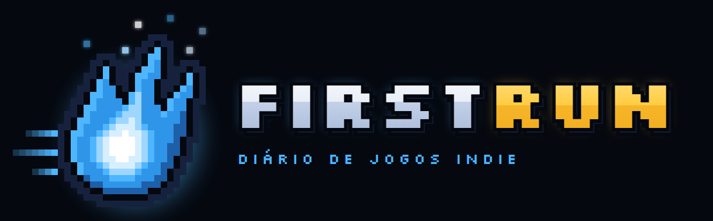

<p align="center">
  
</p>

<h1 align="center">FirstRun</h1>

<p align="center">
  Seu diário de jogos indie: horas jogadas, bosses derrotados e cada tentativa até a vitória, tudo em um lugar só.
</p>

<p align="center">
  
  
  
  
  
  
</p>

<p align="center">
  Projeto individual · Análise e Desenvolvimento de Sistemas · SPTech
</p>

---

## A ideia

Hollow Knight, Celeste, Cuphead, Hades. Muitos dos jogos mais marcantes dos últimos anos foram feitos por equipes pequenas, às vezes por uma pessoa só.

Quem gosta de jogos indie costuma passar por muitos jogos diferentes, e é fácil perder a conta de quanto tempo já jogou, até onde chegou e quantas vezes morreu para aquele boss.

O **FirstRun** é o lugar para guardar essa trajetória. Você registra os jogos que joga, as horas, os bosses que derrotou e quanto cada luta custou, e acompanha tudo no seu perfil e numa dashboard com gráficos.

> Derrotou a Hornet na terceira tentativa? Levou quarenta tentativas no Radiance? Registre, compare e veja seu progresso crescer.

## O que dá para fazer

- 🏠 **Conhecer o mundo indie:** os jogos mais jogados, a história dos indies, curiosidades e um indie para cada tipo de jogador.
- 🎮 **Explorar o catálogo:** cada jogo com seus bosses e a média de tentativas dos jogadores.
- 📝 **Registrar o progresso:** horas jogadas, status (jogando, zerado ou pausado), bosses derrotados, tentativas e a dificuldade de 1 a 5 que você deu para cada um.
- 👤 **Ver o seu perfil:** total de horas, horas de cada jogo e todos os bosses que você já venceu.
- 📊 **Acompanhar a dashboard:** gráficos e indicadores feitos com os seus dados.

## Dashboard

A dashboard transforma o seu progresso em números:

- total de horas jogadas, jogos cadastrados e bosses derrotados;
- o jogo mais jogado e o boss mais difícil;
- porcentagem de conclusão de cada jogo;
- gráficos de horas por jogo e de jogos por status;
- comparação do seu progresso com a média dos jogadores.

## Tecnologias

| Tecnologia | Uso |
| --- | --- |
| HTML e CSS | Estrutura e visual das páginas |
| JavaScript | Interação das páginas e comunicação com a API |
| Node.js | API que liga as páginas ao banco de dados |
| MySQL | Banco de dados, rodando numa máquina virtual Linux |
| Chart.js | Gráficos da dashboard |

## Como rodar

```bash
git clone https://github.com/ernani-carvalho/projeto-individual.git
cd projeto-individual/web-data-viz
npm install
npm start
```

Antes de ligar, crie o banco com o script `web-data-viz/src/database/script-tabelas.sql` e preencha os dados de acesso no arquivo `web-data-viz/.env.dev`.

O site abre em `http://localhost:3333`.

---

<p align="center">
  Feito por Ernani P. Carvalho · <a href="https://github.com/ernani-carvalho">@ernani-carvalho</a>
</p>
